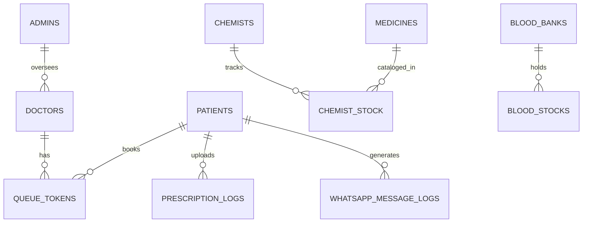

# 🎓 S.E.H.A.T — Comprehensive Viva & Project Defense Master Guide
**Smart Emergency & Healthcare Access Terminal (S.E.H.A.T)**  
*A WhatsApp-First Healthcare Coordination Platform for Semi-Urban and Rural India*

---

## 📑 Quick Navigation
1. [Project Overview & Elevator Pitch](#1-project-overview--elevator-pitch)
2. [Complete Technology Stack & Justifications](#2-complete-technology-stack--justifications)
3. [Database Architecture & The SQLite vs. PostgreSQL Dilemma](#3-database-architecture--the-sqlite-vs-postgresql-dilemma)
4. [Complete Schema & Table Breakdown (All 11 Tables)](#4-complete-schema--table-breakdown-all-11-tables)
5. [Core Algorithms, Calculations & Technical Flows](#5-core-algorithms-calculations--technical-flows)
6. [Security, Privacy & Regulatory Compliance (DPDP / HIPAA)](#6-security-privacy--regulatory-compliance)
7. [System Workspaces & Role-Based Access Control (RBAC)](#7-system-workspaces--role-based-access-control-rbac)
8. [Top 25 Viva Questions & Winning Model Answers](#8-top-25-viva-questions--winning-model-answers)

---

## 1. Project Overview & Elevator Pitch

### 💡 The Problem
In semi-urban and rural Indian healthcare ecosystems (Tier-2/3 cities and villages like the Ghaziabad pilot):
1. **Clinic Overcrowding & Chaotic Queues**: Patients wait 2 to 4 hours in packed waiting rooms with zero visibility into doctor availability or estimated wait times.
2. **Prescription Illiteracy**: Complex handwriting and medical jargon lead to drug non-compliance or wrong dosages.
3. **Information Asymmetry in Pharmacies & Blood Banks**: Patients travel shop-to-shop in emergencies searching for critical medicines or specific blood units (e.g., O-ve, AB-ve) only to find them out of stock.
4. **App Fatigue & Digital Literacy Barrier**: Rural and elderly patients rarely download standalone 100MB mobile apps (e.g., Practo/1mg) due to low device storage, complex registration forms, and language barriers.

### 🚀 The SEHAT Solution
**SEHAT** is a **zero-install, WhatsApp-native healthcare coordination ecosystem**:
- **Patients** interact entirely through **WhatsApp** (which 500M+ Indians already know how to use). They share their GPS location pin to discover nearby clinics, get real-time digital queue tokens with wait time estimates, upload prescription photos for instant AI-driven OCR and Hindi translations, and check real-time blood bank inventory.
- **Healthcare Providers** (Doctors, Chemists, Blood Banks) and **Admins** manage their operations through a lightweight, ultra-responsive, glassmorphic **React Web Portal**.

---

## 2. Complete Technology Stack & Justifications

| Layer | Technology | Why This Specific Tech Was Chosen |
| :--- | :--- | :--- |
| **Backend Framework** | **FastAPI (Python 3.12+)** | Asynchronous ASGI framework; native async/await for high I/O throughput; automatic Swagger/OpenAPI generation; native Pydantic data validation; out-of-band `BackgroundTasks`. |
| **ASGI Server** | **Uvicorn** | Lightning-fast ASGI web server implementation based on `uvloop` and `httptools`. |
| **ORM / Database Engine** | **SQLAlchemy 2.0 (Async)** | Modern async ORM supporting type-annotated mapped columns (`Mapped`, `mapped_column`), relationship lazy/eager loading (`selectinload`), and transparent dialect switching. |
| **Database (Dev)** | **SQLite (`aiosqlite`)** | Zero-configuration, zero-dependency embedded file database (`sehat.db`). Allows instant evaluation without requiring a running database daemon. |
| **Database (Prod)** | **PostgreSQL 15+ (`asyncpg`)** | Enterprise-grade ACID compliance; native JSONB indexing; row-level locking for concurrency; connection pooling (`AsyncEngine`); spatial queries; deployed via Docker / Supabase / Render. |
| **Frontend Framework** | **React 18 (Vite build tool)** | Component-driven SPA; sub-second Hot Module Replacement (HMR); virtual DOM for smooth queue rendering. |
| **Styling** | **TailwindCSS 3.4** | Utility-first CSS; sleek dark-mode glassmorphism (`backdrop-blur-md`, slate-900 palettes); responsive flex/grid layouts. |
| **Icons & Audio** | **Lucide React + Web Audio API** | Vector SVG icons; zero-asset acoustic clinic chimes synthesized mathematically in the browser via `AudioContext` (oscillators + gain nodes). |
| **WhatsApp Gateway** | **UltraMsg WhatsApp Gateway** | Real WhatsApp API with QR code linking, webhook dispatch, and automated outbound messaging without sandbox restrictions. |
| **AI / Multimodal OCR** | **Google Gemini 1.5 Flash / Vision** | State-of-the-art vision model capable of deciphering handwritten doctor prescriptions and structured medicine extraction. |
| **AI / NLP Translation** | **Google Gemini Translation** | Conversational Hindi explanation generator with built-in medical safety disclaimers. |
| **Vector Store / Embeddings** | **ChromaDB** | Vector similarity engine for semantic drug and symptom matching against the CDSCO medicine catalog. |
| **Authentication** | **Local JWT (HS256) + Supabase** | Secure bearer token authentication with role-based claims (`admin`, `doctor`, `chemist`, `blood_bank`). |
| **Containerization** | **Docker & Docker Compose** | Multi-stage Dockerfiles (`python:3.12-slim` backend + `node:20-alpine`/`nginx` frontend + PostgreSQL). |

---

## 3. Database Architecture & The SQLite vs. PostgreSQL Dilemma

### ❓ "Why is SQLite used here instead of only PostgreSQL?" (Crucial Viva Question!)

A frequent examiner trap is: *"Why do you have a SQLite file (`sehat.db`) if your project documentation mentions PostgreSQL?"*

#### The Exact Technical Justification:
1. **Dual-Dialect Production/Development Architecture**:
   The application is written using **SQLAlchemy 2.0 Async abstractions**, which means **not a single line of raw dialect-specific SQL is hardcoded in the application logic**.
2. **Local Portability (Developer Velocity)**:
   - For evaluation, college lab viva, and offline demonstrations, requiring PostgreSQL requires installing external services, setting up port 5432, managing superusers, and configuring pg_hba.conf.
   - By leveraging `sqlite+aiosqlite:///./sehat.db`, the entire backend boots up instantly in 1 second with a single click.
3. **Production PostgreSQL Readiness**:
   - In [`backend/database.py`](file:///c:/Users/YASHASVI%20PANDEY/Desktop/S.E.H.A.T/backend/database.py), the engine dynamically inspects `DATABASE_URL`:
     ```python
     if DATABASE_URL.startswith("postgres://"):
         DATABASE_URL = DATABASE_URL.replace("postgres://", "postgresql+asyncpg://", 1)
     elif DATABASE_URL.startswith("postgresql://"):
         DATABASE_URL = DATABASE_URL.replace("postgresql://", "postgresql+asyncpg://", 1)
     ```
   - In [`docker-compose.yml`](file:///c:/Users/YASHASVI%20PANDEY/Desktop/S.E.H.A.T/docker-compose.yml) and [`schema_and_seed.sql`](file:///c:/Users/YASHASVI%20PANDEY/Desktop/S.E.H.A.T/schema_and_seed.sql), PostgreSQL is configured with full concurrency, connection pooling, and JSONB columns for production deployment.

---

## 4. Complete Schema & Table Breakdown (All 11 Tables)

The SEHAT database is structured into **11 relational tables** adhering to 3rd Normal Form (3NF) with foreign key constraints, cascading deletes, and unique indexing.



### Table Details:

| # | Table Name | Model File | Purpose & Key Columns |
| :- | :--- | :--- | :--- |
| **1** | `admins` | `backend/models/admin.py` | Stores super-administrators who can view/modify all workspaces.<br>• `id` (PK), `email` (Unique), `password_hash` (bcrypt), `name`, `created_at` |
| **2** | `patients` | `backend/models/patient.py` | Profiles registered automatically via WhatsApp interaction.<br>• `id` (PK), `phone` (Unique, indexed), `name`, `language_preference` (`en`/`hi`), `last_search_doctor_ids` (JSON), timestamps |
| **3** | `doctors` | `backend/models/doctor.py` | Registered clinicians, clinic locations, and consulting specs.<br>• `id` (PK), `name`, `specialization`, `phone`, `password_hash`, `clinic_name`, `address`, `latitude`, `longitude`, `is_available` (Boolean), `avg_consultation_minutes` (default 15) |
| **4** | `chemists` | `backend/models/chemist.py` | Pharmacy stores managing medicine inventory.<br>• `id` (PK), `name`, `shop_name`, `phone`, `password_hash`, `address`, `latitude`, `longitude`, `is_open` |
| **5** | `medicines` | `backend/models/chemist.py` | Standard drug catalog based on CDSCO / NLEM.<br>• `id` (PK), `generic_name` (Unique, indexed), `brand_names` (JSON array of strings), `category`, `schedule` (e.g. H, H1, OTC), `standard_dosages` (JSON) |
| **6** | `chemist_stock` | `backend/models/chemist.py` | Junction table mapping medicines to chemist shops.<br>• `id` (PK), `chemist_id` (FK), `medicine_id` (FK), `is_available` (Boolean), `last_updated` (Timestamp). Enforces `UniqueConstraint("chemist_id", "medicine_id")`. |
| **7** | `blood_banks` | `backend/models/blood_bank.py` | Blood storage centers and emergency contact details.<br>• `id` (PK), `name`, `address`, `phone`, `password_hash`, `latitude`, `longitude`, `is_open_24hrs` (Boolean), `opening_time`, `closing_time` |
| **8** | `blood_stocks` | `backend/models/blood_bank.py` | Junction table mapping the 8 blood groups to blood banks.<br>• `id` (PK), `blood_bank_id` (FK), `blood_group` (A+, A-, B+, B-, O+, O-, AB+, AB-), `units_available` (Int), `last_updated`. Enforces `UniqueConstraint("blood_bank_id", "blood_group")`. |
| **9** | `queue_tokens` | `backend/models/token.py` | Real-time queue appointment tokens for clinic visits.<br>• `id` (PK), `doctor_id` (FK), `patient_phone`, `patient_name`, `token_number` (Int), `position` (Int), `status` (`waiting`, `called`, `seen`, `cancelled`), `estimated_wait_minutes`, `booked_at` |
| **10** | `prescription_logs` | `backend/models/token.py` | Permanent audit record of scanned prescriptions.<br>• `id` (PK), `patient_phone` (**Salted SHA-256 Hash** for privacy), `image_url`, `extracted_medicines` (JSON), `matched_chemist_id` (FK nullable), `hindi_explanation` (Text), `ocr_confidence` (Float) |
| **11** | `whatsapp_message_logs` | `backend/models/patient.py` | Rate-limiting and audit log for inbound WhatsApp traffic.<br>• `id` (PK), `patient_phone`, `timestamp` |

---

## 5. Core Algorithms, Calculations & Technical Flows

### A. Geodesic Proximity Search (The Haversine Formula)
To locate clinics and blood banks within 2 to 5 km of a patient's WhatsApp location pin:
$$\Delta \text{lat} = \text{lat}_2 - \text{lat}_1, \quad \Delta \text{lon} = \text{lon}_2 - \text{lon}_1$$
$$a = \sin^2\left(\frac{\Delta \text{lat}}{2}\right) + \cos(\text{lat}_1) \cdot \cos(\text{lat}_2) \cdot \sin^2\left(\frac{\Delta \text{lon}}{2}\right)$$
$$c = 2 \cdot \text{atan2}\left(\sqrt{a}, \sqrt{1 - a}\right)$$
$$d = R \cdot c \quad (\text{where Earth radius } R = 6371.0 \text{ km})$$

Implemented in [`backend/services/location_service.py`](file:///c:/Users/YASHASVI%20PANDEY/Desktop/S.E.H.A.T/backend/services/location_service.py).

### B. Dynamic Queue Wait Time & Reordering Algorithm
1. **Dynamic Wait Estimation**:
   $$\text{Est. Wait Time} = (\text{Position in Queue} - 1) \times \text{Avg Consultation Time (e.g. 15 mins)}$$
2. **Cancellation Shift Algorithm**:
   When a patient texts `"CANCEL"`:
   - Token status changes to `'cancelled'`.
   - All subsequent tokens for that doctor with $\text{position} > \text{cancelled\_position}$ are shifted down:
     $$\text{new\_position} = \text{old\_position} - 1$$
     $$\text{new\_wait} = \text{old\_wait} - 15 \text{ mins}$$
   - Downstream patients automatically receive proactive WhatsApp alerts notifying them that their appointment has moved up.

### C. Asynchronous Non-Blocking Webhook Architecture
WhatsApp webhook connections expect rapid HTTP responses. However, downloading high-resolution prescription images, calling Gemini Vision OCR, matching chemist stock, and generating Hindi translations can take **4 to 8 seconds**.
* **How SEHAT solves this**:
  1. The webhook handler accepts the request, parses the event payload, and acknowledges UltraMsg with an immediate HTTP 200 `{"status": "ok"}` in **< 45ms**.
  2. The heavy OCR and translation pipeline is dispatched via FastAPI `BackgroundTasks`.
  3. Once Gemini finishes processing, SEHAT initiates an **out-of-band outbound WhatsApp push message** via UltraMsg to the patient with the formatted results and 1-tap Google Maps directions.

---

## 6. Security, Privacy & Regulatory Compliance

1. **Patient Health Information (PHI) Anonymization (DPDP Act 2023 & HIPAA)**:
   - In [`backend/services/hash_service.py`](file:///c:/Users/YASHASVI%20PANDEY/Desktop/S.E.H.A.T/backend/services/hash_service.py), permanent audit records (`PrescriptionLog`) never store raw patient phone numbers.
   - Raw phone numbers are transformed using a salted SHA-256 cryptographic hash:
     $$\text{Hashed ID} = \text{SHA256}(\text{raw\_phone} + \text{SECRET\_SALT})$$
2. **Webhook Token Verification**:
   - Protects incoming webhooks from forgery. Validates incoming requests against `WEBHOOK_VERIFY_TOKEN` in [`backend/services/security_checks.py`](file:///c:/Users/YASHASVI%20PANDEY/Desktop/S.E.H.A.T/backend/services/security_checks.py).
3. **Medical Safety Rails & Statutory Disclaimers**:
   - AI translations strictly append non-diagnostic statutory disclaimers:
     > *"यह केवल जानकारी के लिए है। दवा लेने से पहले डॉक्टर की सलाह अवश्य लें।"*  
     > *(This is for informational purposes only. Always consult a licensed physician before taking medication.)*
4. **Daily Queue Caps**:
   - Maximum 50 tokens per doctor per day to protect clinic doctors from burnout and quality degradation.
5. **Stock Staleness Warning**:
   - Chemist and blood stocks not updated in > 24 hours display visual amber alert badges to prevent sending emergency patients to outdated inventories.

---

## 7. System Workspaces & Role-Based Access Control (RBAC)

The system enforces 4 distinct authenticated personas:

```
                  ┌──────────────────────┐
                  │    System Admin      │
                  │   (Full Spectrum)    │
                  └──────────┬───────────┘
         ┌───────────────────┼───────────────────┐
         ▼                   ▼                   ▼
┌─────────────────┐ ┌─────────────────┐ ┌─────────────────┐
│ Doctor Workspace│ │Chemist Workspace│ │Blood Bank Space │
│  (Live Queue,   │ │ (Drug Catalog,  │ │  (8-Group Unit  │
│   Audio Chime,  │ │  Stock Toggle,  │ │   Adjustments,  │
│  Prescription)  │ │ Stale Warnings) │ │ 24-hr Emergency)│
└─────────────────┘ └─────────────────┘ └─────────────────┘
```

1. **Doctor Portal**: Live queue board, audio chimes on calling patients, clinic availability toggle, patient prescription review cards.
2. **Chemist Portal**: Real-time drug inventory toggles, CDSCO medicine search, staleness indicators.
3. **Blood Bank Portal**: Live grid of all 8 blood groups (A+, A-, B+, B-, O+, O-, AB+, AB-), unit count controls, 24-hour open indicators.
4. **Admin Control Center**:
   - Cross-workspace multi-profile switcher (allows inspecting/editing *any* doctor, chemist, or blood bank from a dropdown).
   - System Health and Integration status monitors.
   - Registered Patients Directory table.
   - Prescription Scans Log with OCR confidence and Hindi explanations.

---

## 8. Top 25 Viva Questions & Winning Model Answers

### Q1: What is the USP (Unique Selling Proposition) of SEHAT?
> **Answer**: Zero-installation healthcare coordination. By leveraging WhatsApp as the user interface, we eliminate the friction of app downloads, account creations, and language barriers for rural and semi-urban patients, while providing doctors and chemists with structured web dashboards.

### Q2: Why did you choose FastAPI over Django or Flask?
> **Answer**: FastAPI is built on ASGI (Starlette) and supports native asynchronous Python (`async`/`await`). It handles thousands of concurrent I/O-bound connections (e.g. UltraMsg WhatsApp webhooks, database queries, and external AI calls) with minimal memory footprint compared to synchronous WSGI frameworks like Flask or Django. Additionally, automatic Pydantic validation and OpenAPI documentation accelerate development.

### Q3: How does the system prevent WhatsApp webhook timeouts during image processing?
> **Answer**: WhatsApp gateways require an immediate HTTP 200 acknowledgment within a few seconds to prevent retry storms. Downloading an image and passing it to Google Gemini takes several seconds. We decouple the flow using FastAPI `BackgroundTasks`: the webhook returns an immediate HTTP 200 response in under 50ms, and the background worker processes the image and pushes the final result to the user asynchronously via UltraMsg's REST API.

### Q4: Explain the Haversine formula and why it is used.
> **Answer**: The Haversine formula calculates the great-circle distance between two points on a sphere given their longitudes and latitudes. We use it to compute the exact geographical distance between a patient's GPS pin and registered clinics or blood banks to rank them by proximity.

### Q5: How do you protect patient privacy in accordance with healthcare regulations?
> **Answer**: In accordance with India's Digital Personal Data Protection (DPDP) Act and HIPAA guidelines, we implement salted SHA-256 hashing on patient phone numbers before storing them in permanent clinical audit tables like `prescription_logs`. Even in the event of a database breach, patient identities cannot be reverse-engineered.

### Q6: What happens if two patients book a token at the exact same millisecond?
> **Answer**: In PostgreSQL, we utilize database transactions with row-level locking (`SELECT ... FOR UPDATE`) or atomic SQL sequence increments on the token number column. In SQLite, the database handles writes sequentially with write-ahead logging (WAL), guaranteeing unique, sequential token numbers without race conditions.

### Q7: What is the purpose of the Web Audio API chime on the Doctor Dashboard?
> **Answer**: In busy clinics, doctors and compounders cannot keep staring at a computer screen. When the "Call Patient" button is clicked, our frontend uses the browser's native `AudioContext` to synthesize an audible two-tone alert chime (659Hz E5 to 523Hz C5) directly through the hardware speakers without needing external audio files.

### Q8: What if a handwritten prescription is blurry or unreadable?
> **Answer**: Google Gemini Vision returns an `ocr_confidence` score. If confidence falls below 0.60 or if no valid medicine names can be resolved against the medical catalog, the bot sends a polite fallback message asking the patient to upload a clearer, well-lit photo from directly above the paper.

### Q9: How is the database seeded, and how many records currently exist?
> **Answer**: The database is seeded via `schema_and_seed.sql`. It initializes 1 Admin, 5 Patients, 5 Doctors, 5 Chemists with CDSCO medicine stocks, and 5 Blood Banks with stock levels across all 8 blood groups in the Ghaziabad pilot area.

### Q10: What is the 24-hour stock staleness rule?
> **Answer**: To prevent patients in medical emergencies from traveling to a shop for medicines or blood units that were sold hours ago, any stock entry whose `last_updated` timestamp is older than 24 hours is flagged with an amber "Stale Stock Data" warning.

### Q11: How do you handle medicine brand names vs. generic names?
> **Answer**: Our `medicines` schema stores the INN generic name (e.g. *Paracetamol*) and a JSON array of popular commercial brand names (e.g. `["Crocin", "Calpol", "Dolo 500"]`). When an OCR scan or text search occurs, matching queries against both generic and brand aliases.

### Q12: Why did you choose ChromaDB?
> **Answer**: ChromaDB is an open-source embedding database. It allows us to perform semantic vector searches—for example, matching misspelled drug names or symptom descriptions to the closest approved medical catalog entries.

### Q13: How does the Admin multi-profile switcher work?
> **Answer**: Admins have supervisory access. When an admin views the Doctor, Chemist, or Blood Bank dashboards, the header dynamically renders a workspace selector dropdown. Selecting an entity updates the component state (e.g. `activeDoctorId`), re-fetching and displaying that specific clinician's live queue or inventory.

### Q14: How does SEHAT handle doctor availability changes?
> **Answer**: When a doctor toggles clinic status to "Unavailable / Closed", the system marks `is_available = False`. If a patient attempts to book with that doctor via WhatsApp, the bot informs them that the clinic is closed and suggests alternative open clinics nearby.

### Q15: How does token cancellation affect other patients in the queue?
> **Answer**: When a token is cancelled, our queue service shifts the queue positions of all subsequent patients down by 1, recalculates their estimated wait times, and triggers outbound WhatsApp notifications to alert them that their consultation time has moved up.

### Q16: What is the function of the midnight cron scheduler?
> **Answer**: Clinic queues are day-specific. In `backend/main.py`, a background asyncio loop checks at midnight (00:00) and automatically cancels any leftover tokens from the previous day, ensuring doctors start with a fresh queue every morning.

### Q17: What security measures prevent WhatsApp webhook spoofing?
> **Answer**: In production, `backend/services/security_checks.py` validates incoming HTTP requests against a secure pre-shared token (`WEBHOOK_VERIFY_TOKEN`) using constant-time string comparison (`hmac.compare_digest`), ensuring only genuine requests originating from the authorized UltraMsg WhatsApp gateway are processed.

### Q18: What is Pydantic's role in this architecture?
> **Answer**: Pydantic v2 powers our schemas in `backend/schemas/`. It enforces strict runtime type validation, parses incoming JSON payloads, sanitizes inputs, and serializes database models into API response structures.

### Q19: Can SEHAT work without an internet connection on the patient's side?
> **Answer**: Because SEHAT operates on WhatsApp, patients only need minimal mobile data (2G/3G/4G) sufficient for sending text messages or photos. They do not need high-speed internet to download or update apps.

### Q20: How are passwords stored in the database?
> **Answer**: Passwords for doctors, chemists, blood bank managers, and admins are never stored in plaintext. They are hashed using `bcrypt` with salt rounds ($2b$12), protecting credentials against rainbow table and dictionary attacks.

### Q21: What is the difference between Schedule H, H1, and OTC medicines?
> **Answer**: In India's Drugs and Cosmetics Rules, Schedule H and H1 drugs (e.g. antibiotics, psychotropics) cannot be sold without a registered medical practitioner's prescription. OTC (Over-the-Counter) drugs can be sold freely. Our medicine catalog tracks this via the `schedule` column.

### Q22: Why did you use React with Vite instead of Create React App (CRA)?
> **Answer**: Create React App is deprecated and uses Webpack, which is slow. Vite uses native ES Modules (ESM) during development and Rollup for production builds, providing instant server start and significantly faster Hot Module Replacement.

### Q23: How do chemists update their inventory?
> **Answer**: Chemists search for medicines using an autocomplete search bar that queries the CDSCO catalog. Clicking "Add Stock" links the drug to their shop. They can then toggle availability on/off with a single click.

### Q24: What are the daily token booking limits?
> **Answer**: Each doctor clinic has a strict cap of 50 tokens per day. Once 50 tokens are booked, the bot politely informs subsequent patients that the clinic has reached full capacity for the day.

### Q25: How would you scale SEHAT to all of India?
> **Answer**: 
> 1. Migrate the database to a distributed PostgreSQL cluster with read replicas and connection poolers (e.g. PgBouncer).
> 2. Use Celery with Redis for distributed task queues instead of local background tasks.
> 3. Implement Redis caching for doctor proximity searches and medicine catalogs.
> 4. Deploy Docker containers across Kubernetes (EKS/GKE) with horizontal pod autoscaling.
