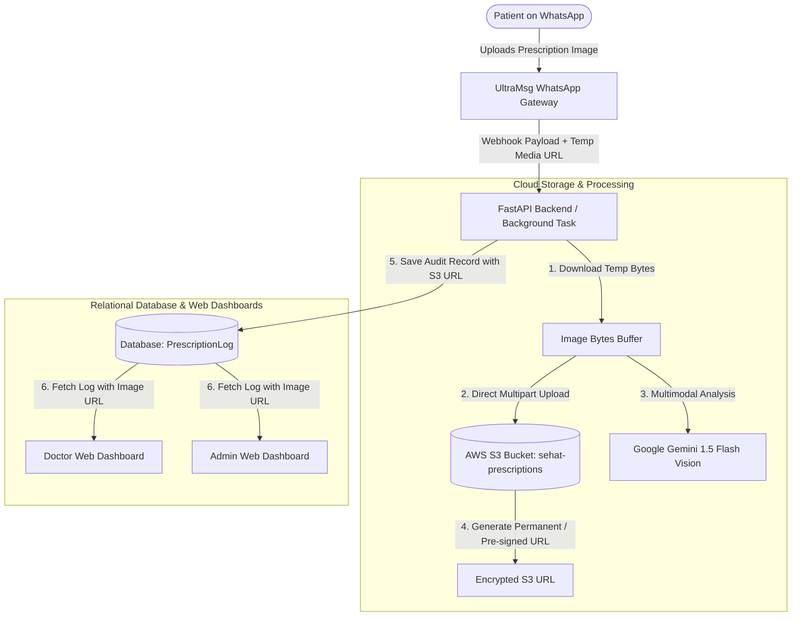
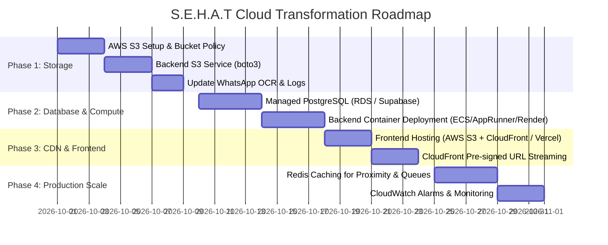

# Implementation Plan & Cloud Roadmap: AWS S3 & Cloud Architecture for S.E.H.A.T

This document outlines the architectural plan, technical specifications, and step-by-step roadmap to integrate **AWS S3 (Simple Storage Service)** for medical image/prescription storage, along with a strategic roadmap for adopting cloud services across the entire S.E.H.A.T ecosystem.

---

## 1. Problem Statement & Motivation

Currently, when a patient uploads a prescription photo via WhatsApp:
1. **Temporary CDN Links**: UltraMsg provides an ephemeral media link (`https://file.ultramsg.com/...`) which expires after a few days.
2. **Broken Audit Trail**: When a Doctor or Admin reviews past prescription logs in the web dashboard weeks later, the image link fails or returns a 404 error.
3. **Data Sovereignty & Compliance (DPDP Act / HIPAA)**: Medical images containing sensitive patient health information (PHI) should be stored in an encrypted, access-controlled cloud object storage with retention policies and pre-signed access.

---

## 2. Recommended Cloud Architecture for S.E.H.A.T



---

## 3. Core Technical Decisions for AWS S3

### A. Bucket Configuration & Security (DPDP & HIPAA Compliance)
1. **Private Bucket by Default**: The S3 bucket will have **Block Public Access** enabled.
2. **Server-Side Encryption (SSE-S3)**: All objects encrypted at rest using AES-256 (`x-amz-server-side-encryption: AES256`).
3. **Structured S3 Object Key Path**:
   ```
   prescriptions/{patient_phone_hash}/{yyyy-mm-dd}/{uuid4}.jpg
   ```
   *Keeps patient PII anonymous while organizing files chronologically.*
4. **Lifecycle Rules**: Automatically transition older prescriptions to S3 Standard-IA (Infrequent Access) after 90 days and Glacier after 365 days to reduce cloud storage costs by up to 70%.
5. **Secure Access via Pre-Signed URLs**:
   - For web dashboard viewing (Doctor/Admin), the API generates a time-limited Pre-Signed URL (e.g., valid for 60 minutes).
   - This ensures medical files are never exposed publicly to the internet.

### B. Software Library Selection
- **`boto3`** / **`aioboto3`**: AWS SDK for Python.
- To maintain FastAPI's high async throughput without blocking the event loop:
  - Option 1 (Async): `aioboto3` with `aiofiles`.
  - Option 2 (Standard Boto3 via ThreadPool / FastAPI BackgroundTasks): Run standard `boto3.client('s3').upload_fileobj()` inside the existing async background worker.

---

## 4. Phase-by-Phase Cloud Roadmap



### Phase 1: AWS S3 Object Storage Integration (Immediate Next Step)
- Create S3 bucket: `sehat-prescriptions-prod`.
- Implement `backend/services/storage_service.py` with:
  - `upload_prescription_image(image_bytes, patient_phone_hash, content_type)`
  - `generate_presigned_url(s3_key, expiration_seconds=3600)`
- Update `process_prescription_background` in [`backend/routers/whatsapp.py`](file:///c:/Users/YASHASVI%20PANDEY/Desktop/S.E.H.A.T/backend/routers/whatsapp.py):
  - Download from UltraMsg -> Upload to S3 -> Save S3 key in `PrescriptionLog.image_url`.
- Update Doctor & Admin API responses in `backend/routers/doctors.py` and `backend/routers/admin.py` to return valid pre-signed viewing URLs.

### Phase 2: Cloud Database & Backend Migration
- **Managed Database**: Migrate from local SQLite (`sehat.db`) to **AWS RDS for PostgreSQL** (or **Supabase PostgreSQL**).
- **Backend Containerization**: Deploy FastAPI backend on **AWS App Runner** or **AWS ECS (Fargate)** with auto-scaling (1 to 5 instances).
- **Domain & SSL**: Secure custom domain with AWS Certificate Manager (ACM) or Cloudflare.

### Phase 3: Global CDN & Edge Distribution
- **Frontend Hosting**: Deploy Vite React frontend to **AWS S3 + CloudFront** (or Vercel / Cloudflare Pages) for sub-second page loads across India.
- **UltraMsg Webhook Endpoint**: Direct UltraMsg traffic through an AWS Application Load Balancer (ALB) or API Gateway with HTTPS, eliminating the need for local Ngrok tunnels in production.

### Phase 4: Reliability, Caching & Monitoring
- **AWS ElastiCache (Redis)**: Cache nearest chemist/clinic queries and active queue states to reduce database reads by 80%.
- **AWS CloudWatch & CloudTrail**: Centralized logging for doctor calls, token transactions, and DPDP audit compliance.

---

## 5. Proposed Changes for Phase 1 (S3 Integration)

### Dependencies
#### [MODIFY] [`backend/requirements.txt`](file:///c:/Users/YASHASVI%20PANDEY/Desktop/S.E.H.A.T/backend/requirements.txt)
- Add `boto3>=1.34.0` (AWS SDK for Python)

### Configuration
#### [MODIFY] [`.env`](file:///c:/Users/YASHASVI%20PANDEY/Desktop/S.E.H.A.T/.env)
- Add AWS configuration credentials:
  ```env
  AWS_ACCESS_KEY_ID=your_access_key
  AWS_SECRET_ACCESS_KEY=your_secret_key
  AWS_REGION=ap-south-1  # Asia Pacific (Mumbai) for low latency in India
  AWS_S3_BUCKET_NAME=sehat-prescriptions
  ```

### New Storage Service
#### [NEW] [`backend/services/storage_service.py`](file:///c:/Users/YASHASVI%20PANDEY/Desktop/S.E.H.A.T/backend/services/storage_service.py)
- Encapsulate all AWS S3 operations:
  - `upload_file_bytes()`
  - `get_presigned_download_url()`
  - Graceful fallback: If AWS keys are not configured, fallback to storing files in a local `/uploads/prescriptions/` folder so local development never breaks!

### Router Updates
#### [MODIFY] [`backend/routers/whatsapp.py`](file:///c:/Users/YASHASVI%20PANDEY/Desktop/S.E.H.A.T/backend/routers/whatsapp.py)
- In `process_prescription_background`, call `storage_service.upload_prescription_image` and save the permanent S3 key into `PrescriptionLog.image_url`.
#### [MODIFY] [`backend/routers/doctors.py`](file:///c:/Users/YASHASVI%20PANDEY/Desktop/S.E.H.A.T/backend/routers/doctors.py)
- Convert stored S3 keys into fresh pre-signed URLs when returning recent prescription scans to the Doctor dashboard.
#### [MODIFY] [`backend/routers/admin.py`](file:///c:/Users/YASHASVI%20PANDEY/Desktop/S.E.H.A.T/backend/routers/admin.py)
- Convert stored S3 keys into fresh pre-signed URLs when returning audit logs.

---

## 6. Verification Plan

### Automated / Scripted Tests
- Create `test_s3_upload.py` to verify:
  1. Uploading sample prescription bytes to S3.
  2. Generating a pre-signed URL and verifying HTTP 200 via `httpx`.
  3. Validating fallback mode when AWS keys are absent.

### Manual Verification
- Send a sample prescription image via WhatsApp (`reply_whatsapp.py`).
- Check S3 bucket via AWS Console to verify object exists under `prescriptions/{hash}/{date}/...`.
- Open Doctor Dashboard -> Verify prescription image renders immediately and stays accessible permanently.
